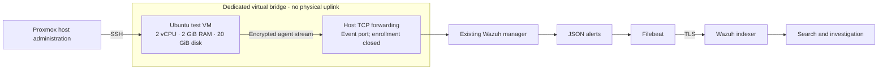

# Wazuh File Integrity Monitoring Lab

**Proxmox VE · Ubuntu · Real-time monitoring · Verified indexed evidence**

A completed security engineering project that follows controlled file changes from a dedicated Linux endpoint through Wazuh analysis and alert indexing. The exercise verifies creation, modification, and deletion events, checks file hashes, and records network restrictions and service continuity.

[Download the plain-English PDF summary](plain-english-summary.pdf) · [Security review](docs/security-review.md)

## Follow-up kernel review

Reviewed the remaining kernel inventory against Ubuntu advisories and applied targeted restrictions to the dedicated practice VM. The unused Xen backend is denied through normal module loading; unprivileged user namespace creation is disabled; kernel pointer visibility is restricted. Reboot persistence, file-change alerts, network restrictions, and existing service continuity passed. These controls reduce exposure without suppressing findings.

[Review, remaining work, and rollback](docs/kernel-findings-review.md) · [Per-CVE spreadsheet](evidence/kernel-triage.csv) · [Post-reboot validation](evidence/kernel-hardening-validation.json)

## Verified results

Live validation completed on **November 24, 2026**.

| Operation | Wazuh rule | Level | Manager alert | Indexed document | First indexed observation |
| --- | --- | --- | --- | --- | --- |
| Create file | **554** — File added to the system | 5 | Verified | Verified | **9.76 seconds** |
| Modify file | **550** — Integrity checksum changed | 7 | Verified | Verified | **10.80 seconds** |
| Delete file | **553** — File deleted | 7 | Verified | Verified | **16.46 seconds** |

All three events reported `realtime` mode. The event identifiers matched between the manager and indexer. SHA-256 values matched the generated file contents, and the modification event recorded the expected before/after hashes.

The timing figures are observations from one run with approximately three-second polling and include query overhead. They describe this exercise's end-to-end visibility, rather than a general performance guarantee.

## Architecture

The test guest has no default gateway. Its firewall permits host-originated SSH administration and agent connections to the host forwarding ports. The bridge has no physical interface. Forwarding preserves the Wazuh agent stream and uses the existing manager as its destination.

## What was built

- A dedicated Ubuntu 24.04.5 LTS VM using an official cloud image checked against its published SHA-256 manifest.
- A separate virtual bridge and scoped guest/host firewall rules.
- Host socket-activated TCP event forwarding; the enrollment forwarder was used for setup and subsequently disabled.
- A Wazuh 4.14.8 agent enrolled with the existing 4.14.8 manager.
- A real-time FIM watch on `/opt/security-lab/fim`, including checksum checks and changes to the exercise's synthetic text.
- A controlled three-operation experiment with manager-side and indexed evidence.

The exercise used Wazuh's built-in rules. [Official FIM settings](https://documentation.wazuh.com/current/user-manual/capabilities/file-integrity/basic-settings.html)

## Network and continuity checks

The original evidence records enrollment as reachable during setup. The later security review records its closure for normal operation.

| Check from the test guest | Result |
| --- | --- |
| Wazuh event forwarding port | Reachable |
| Wazuh enrollment forwarding port | Closed after enrollment |
| Proxmox administration port | Blocked |
| Selected media service | Unreachable |
| Public HTTPS destination | Unreachable |

All existing media container IDs were preserved. Nine media/dashboard endpoints returned HTTP 200 after testing, and the manager, indexer, dashboard, and Filebeat services were active. The new agent was active and the test directory was empty after the final deletion.

## Project documentation

| Document | Contents |
| --- | --- |
| [Executive summary](SUMMARY.md) | Objective, implementation, results, and conclusions |
| [Architecture and access](docs/architecture.md) | Network boundaries, forwarding, and data flow |
| [Build and test procedure](docs/build-and-test.md) | Provisioning, configuration, enrollment, and reproduction |
| [Investigation](docs/investigation.md) | Rule interpretation, hashes, evidence, and timing |
| [Operations and cleanup](docs/operations-and-cleanup.md) | Operating the guest, access, recovery scope, and teardown |
| [FIM configuration](config/fim-syscheck.xml) | The lab's monitored directory and scan settings |
| [Network templates](config/network-policy.md) | Bridge, firewall, and socket-forwarding configuration |
| [Detection evidence](evidence/results.json) | Sanitized results from the live experiment |
| [Network evidence](evidence/network-checks.json) | Positive and negative connection checks |

## Operating scope

The test VM remains available for further exercises and has automatic host-boot startup disabled. Its administrative SSH key is stored privately on the Proxmox host. The lab has no general internet access, so package provisioning was performed through the host.

The project validated indexed evidence through the indexer API. The dashboard can search that data, and its web endpoint was checked. A dashboard screenshot is a separate presentation artifact.

The homelab's guest backup job currently has an unresolved capacity limitation. This lab is outside that job's explicit guest list. Its configuration and reproduction steps are documented here, and recovery of the live guest still requires a usable backup or rebuild.

## Related work

[Wazuh deployment and operations](https://github.com/J0N3B0I/Wazuh-Homelab) · [Proxmox homelab](https://github.com/J0N3B0I/Proxmox-homelab)
