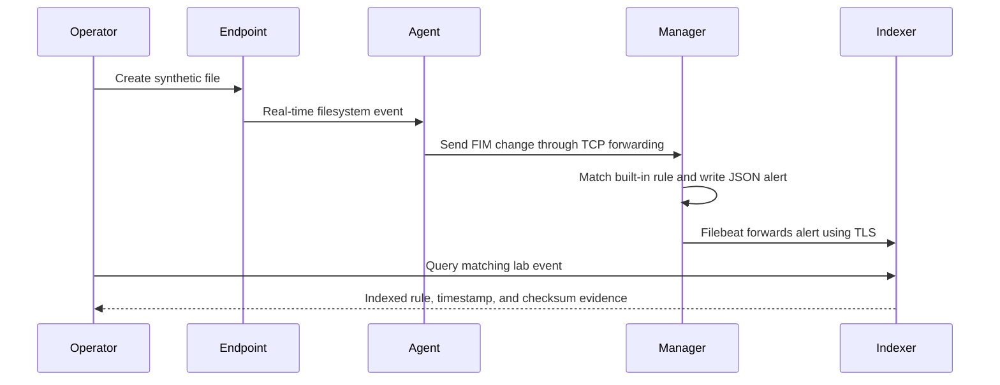

# Architecture and Access Boundaries

## Compute

The endpoint is a separate Proxmox VM running Ubuntu 24.04.5 LTS. It has 2 vCPU, 2 GiB RAM, and a 20 GiB disk. It shares the physical hypervisor with the existing workloads.

The Wazuh manager, indexer, dashboard, and Filebeat continue to run in their existing VM. The endpoint adds a fourth remote agent to that deployment. The manager-local monitoring source remains separate from remote-agent counts.

## Network

The lab's virtual bridge has no physical uplink. The guest is configured with a static address on that bridge and no default gateway. Administration originates from the Proxmox host over SSH.

| Direction | Allowed path | Purpose |
| --- | --- | --- |
| Host to lab VM | TCP 22 | SSH administration with a dedicated private key |
| Lab VM to host lab address | TCP 1514 | Agent event stream forwarding |
| Lab VM to host lab address | TCP 1515 | Provisioning only; now denied and listener disabled |
| Guest incoming/outgoing | Default deny outside permitted paths | Restrict lab connectivity |

The host has an additional narrow incoming rule for the lab guest and the event forwarding port. Existing host firewall configuration was backed up before the additive edit. Proxmox firewall compilation passed after configuration.

## Forwarding services

The event socket listens on the host's lab-facing address. The enrollment socket was used during setup and is now disabled. The event socket activates `systemd-socket-proxyd`, which forwards the connection to the corresponding Wazuh manager port.

The proxies use dynamic service users, restricted filesystem access, and a 64 MiB service memory limit. They forward the byte stream without terminating the Wazuh agent protocol. Their destination is fixed in the private host configuration.

This provides manager connectivity while the test guest has no route to the home LAN. It also causes network-level peer information at the manager to reflect the forwarding host. Agent identity remains associated with the enrolled agent's key and name.

## Evidence path

## Boundary checks

Initial targeted probes reached both provisioning ports. After hardening, event forwarding remained reachable and enrollment was blocked. Probes to the host administration port, a selected media service, and a public HTTPS destination failed. The bridge, guest routes, firewall settings, and these observations collectively describe the tested boundary.

The lab is administered through the hypervisor and is not a high-availability deployment. Its single-guest tests do not establish broad network-security or performance guarantees.
